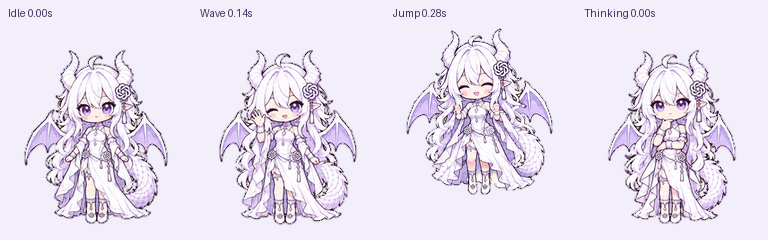

# gpt龙娘

用户选定的白发紫瞳 Q 版龙娘，保留显眼双角、展开的淡紫龙翼、合身白裙、卷尾及 OpenAI 结形发饰。包含九种状态动画、十六方向注视和离线预览。


## 预览与使用

1. 下载完整仓库，双击 `index.html`。预览不需要网络、API Key 或 Node.js。
2. 切换动作、背景和显示宽度；“跟随注视”用于查看十六方向，“连续切换动作”检查状态转换。
3. Mac 本地文件安装：双击 `安装本地版.command`，随后在设置 → Pets 刷新并选择 gpt龙娘。详见 [安装说明](local-install.html)。

**本地文件安装不保证当前客户端保持离线加载。** 本机已观察到自动云迁移，用户复测也仍会加载失败。本次仅更新形象和名称，没有修改客户端，也不宣称修复宿主的透明故障。[加载路径核对](docs/display-troubleshooting.md)。原生目录沿用 `shuangli-local`，以保留现有本地条目身份。

## 用户选定的形象


按用户明确选定的详细版本制作，保留服装纹样、腰饰和靴饰，不再继续简化或改变头身比例。左右移动分别生成，避免镜像改变发饰所在侧。显示大小仍由 Pets 设置控制，单帧固定 192 × 208。

## 动画规格

| 项目 | 规格 |
| --- | --- |
| 图集 | 透明 RGBA PNG，1536 × 2288 |
| 网格 | 8 列 × 11 行，单格 192 × 208 |
| 帧数 | 73 个必要帧，15 个未用单元透明 |
| 动作 | 待机、右移、左移、挥手、跳跃、失落、等待、思考、检查 |
| 注视 | 从正上方起顺时针每隔 22.5°，共 16 个方向 |



## 校验与导出

开发需要 Python 3.12+，依赖固定为 Pillow 12.3.0；本地安装器只需要 Python 3.9+ 标准库。

```bash
python3 -m venv .venv
source .venv/bin/activate
python -m pip install -r requirements.txt
python scripts/validate.py
python scripts/render.py
python -m unittest discover -s tests -v
```

Windows 可用 `.venv\Scripts\activate` 激活环境。可选 MP4 导出需要 PATH 中的 FFmpeg，再运行 `python scripts/render.py --mp4`。

校验器覆盖格式、校验和、帧占用、透明留白、跳跃位移及链接；几何边界使用 A > 16，未用单元要求完全透明。它不能替代人工检查表情、肢体、发饰身份、注视语义或实际宿主运行。

[制作说明](docs/creation.md) · [验收摘要](docs/qa.json) · [参考来源](ASSETS.md)。预览从已提交图集导出，不承诺仅靠提示词逐像素复现生成结果。

## 许可

自编程序与文档采用 [MIT](LICENSE)。视觉素材不包含在代码 MIT 许可中，第三方角色与商标权利说明见 [ASSETS.md](ASSETS.md)。该形象为用户选择的 ChatGPT 拟人创作，不是 OpenAI 官方角色。
